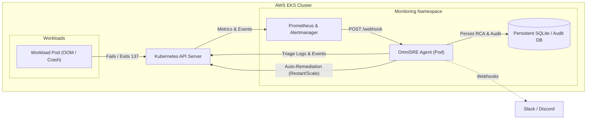

# 🚀 OmniSRE: Real AWS EKS Production Deployment & Chaos Testing Guide

This guide provides end-to-end instructions for deploying **OmniSRE** onto a live AWS Elastic Kubernetes Service (EKS) cluster and executing real-world chaos experiments to verify autonomous incident triage and self-healing.

---

## 📋 Table of Contents
1. [Architecture & Flow](#1-architecture--flow)
2. [Prerequisites](#2-prerequisites)
3. [Step 1: Connect to AWS EKS Cluster](#step-1-connect-to-aws-eks-cluster)
4. [Step 2: Build & Push Docker Image](#step-2-build--push-docker-image)
5. [Step 3: Deploy OmniSRE via Helm](#step-3-deploy-omnisre-via-helm)
6. [Step 4: Verify OmniSRE Pod & Service Health](#step-4-verify-omnisre-pod--service-health)
7. [Step 5: Alertmanager Webhook Integration](#step-5-alertmanager-webhook-integration)
8. [Step 6: Real Chaos Testing Scenarios](#step-6-real-chaos-testing-scenarios)
   - [Experiment 1: Real OOMKilled Pod (Exit Code 137)](#experiment-1-real-oomkilled-pod-exit-code-137)
   - [Experiment 2: Real CrashLoopBackOff Pod (Exit Code 1)](#experiment-2-real-crashloopbackoff-pod-exit-code-1)
   - [Experiment 3: Real Database Deadlock & Health Failure](#experiment-3-real-database-deadlock--health-failure)
9. [Step 7: SOC2 Audit & Incident Verification](#step-7-soc2-audit--incident-verification)
10. [Clean-Up & Teardown](#clean-up--teardown)

---

## 1. Architecture & Flow



---

## 2. Prerequisites

Ensure you have the following installed on your machine:
- **AWS CLI v2** configured with proper IAM credentials (`aws configure`)
- **kubectl** configured to target your EKS cluster
- **Helm v3** (`helm version`)
- **Docker** desktop / engine running

---

## 3. Step 1: Connect to AWS EKS Cluster

Update your local kubeconfig to point to your live EKS cluster:

```powershell
# Replace with your cluster name and AWS region
aws eks update-kubeconfig --name <YOUR_EKS_CLUSTER_NAME> --region ap-south-1

# Verify cluster connection
kubectl get nodes -o wide
```

---

## 4. Step 2: Build & Push Docker Image

You can push the OmniSRE image to **AWS ECR** or **Docker Hub**.

### Option A: Using AWS ECR (Recommended for EKS)

```powershell
# 1. Set environment variables
$AWS_REGION = "ap-south-1"
$AWS_ACCOUNT_ID = (aws sts get-caller-identity --query "Account" --output text)
$ECR_REPO = "$AWS_ACCOUNT_ID.dkr.ecr.$AWS_REGION.amazonaws.com/omnisre"

# 2. Create ECR repository (if it doesn't already exist)
aws ecr create-repository --repository-name omnisre --region $AWS_REGION

# 3. Authenticate Docker with ECR
aws ecr get-login-password --region $AWS_REGION | docker login --username AWS --password-stdin "$AWS_ACCOUNT_ID.dkr.ecr.$AWS_REGION.amazonaws.com"

# 4. Build and push the image
docker build -t "$ECR_REPO:1.0.0" .
docker push "$ECR_REPO:1.0.0"
```

### Option B: Using Public Docker Hub

```powershell
docker login
docker build -t <YOUR_DOCKERHUB_USERNAME>/omnisre:1.0.0 .
docker push <YOUR_DOCKERHUB_USERNAME>/omnisre:1.0.0
```

---

## 5. Step 3: Deploy OmniSRE via Helm

Deploy OmniSRE into the `monitoring` namespace using our pre-built Helm chart:

```powershell
# 1. Ensure monitoring namespace exists
kubectl create namespace monitoring --dry-run=client -o yaml | kubectl apply -f -

# 2. Install OmniSRE using your image
helm upgrade --install omnisre ./charts/omnisre `
  --namespace monitoring `
  --set image.repository="$AWS_ACCOUNT_ID.dkr.ecr.$AWS_REGION.amazonaws.com/omnisre" `
  --set image.tag="1.0.0" `
  --set config.k8sInCluster=true `
  --set config.k8sMockMode=false `
  --set config.autoRemediationEnabled=true `
  --set persistence.enabled=false
```

> [!TIP]
> If you want persistent SQLite storage backed by an AWS EBS volume (gp3/gp2), add:
> `--set persistence.enabled=true --set persistence.size=5Gi`

---

## 6. Step 4: Verify OmniSRE Pod & Service Health

Check that OmniSRE is running and the Kubernetes RBAC permissions are active:

```powershell
# Check pods and services in monitoring namespace
kubectl get pods,svc -n monitoring -l app.kubernetes.io/name=omnisre

# Inspect OmniSRE startup logs
kubectl logs -n monitoring -l app.kubernetes.io/name=omnisre -f
```

You should see:
```text
INFO:     Started server process
INFO:     Waiting for application startup.
INFO:     OmniSRE Agent initialized. InCluster: True, MockMode: False
INFO:     Application startup complete.
INFO:     Uvicorn running on http://0.0.0.0:8000
```

### Access the Web Dashboard:
Forward port 8000 to your local browser:

```powershell
kubectl port-forward -n monitoring svc/omnisre 8000:8000
```
Open **`http://localhost:8000`** in your browser to view the live dark-mode OmniSRE UI!

---

## 7. Step 5: Alertmanager Webhook Integration

If you have Prometheus Operator / kube-prometheus-stack deployed, update Alertmanager to route alerts to OmniSRE:

```yaml
# In Alertmanager configuration (receivers section):
receivers:
  - name: 'omnisre-agent'
    webhook_configs:
      - url: 'http://omnisre.monitoring.svc.cluster.local:8000/webhook'
        send_resolved: true
```

---

## 8. Step 6: Real Chaos Testing Scenarios

We have prepared 3 turnkey chaos manifests in `examples/e2e-chaos-tests/`.

### Experiment 1: Real OOMKilled Pod (Exit Code 137)

Trigger a real Linux Kernel OOM killer event:

```powershell
# 1. Apply the memory-hogging pod
kubectl apply -f examples/e2e-chaos-tests/01-oom-kill-chaos.yaml

# 2. Watch the pod crash with OOMKilled
kubectl get pods -l app=demo-oom-service -w
```

Within seconds, Kubernetes marks the container `OOMKilled` (Exit Code 137).
Now trigger remediation via the Webhook or the Dashboard UI:

```powershell
# Forward the alert or trigger via curl:
curl -X POST http://localhost:8000/simulate `
  -H "Content-Type: application/json" `
  -d '{\"scenario\": \"oom_killed\", \"pod_name\": \"demo-oom-service\", \"namespace\": \"default\"}'
```

**Expected Result:**
1. OmniSRE inspects `kubectl get pod -o json` and identifies `lastState.terminated.exitCode == 137`.
2. Matches policy `auto-recover-oom`.
3. Issues `RESTART_POD` to Kubernetes API.
4. Logs RCA report with SOC2 audit entry in SQLite.

---

### Experiment 2: Real CrashLoopBackOff Pod (Exit Code 1)

```powershell
# 1. Apply faulty release pod
kubectl apply -f examples/e2e-chaos-tests/02-crashloop-chaos.yaml

# 2. Triage via OmniSRE
curl -X POST http://localhost:8000/simulate `
  -H "Content-Type: application/json" `
  -d '{\"scenario\": \"crashloop\", \"pod_name\": \"demo-crashloop-service\", \"namespace\": \"default\"}'
```

**Expected Result:**
- OmniSRE detects exit code 1, pulls dead container logs (`previous=True`), detects entrypoint failure, and initiates rollback/restart.

---

### Experiment 3: Real Database Deadlock & Health Failure

```powershell
# 1. Apply mock database with decaying liveness probe
kubectl apply -f examples/e2e-chaos-tests/03-database-socket-hang-chaos.yaml

# 2. Trigger auto-healing
curl -X POST http://localhost:8000/simulate `
  -H "Content-Type: application/json" `
  -d '{\"scenario\": \"mongodb_down\", \"pod_name\": \"demo-mongodb-service\", \"namespace\": \"default\"}'
```

---

## 9. Step 7: SOC2 Audit & Incident Verification

View all stored incidents and post-mortems in the Web Dashboard or query the API:

```powershell
# Query all audit post-mortems via API
curl http://localhost:8000/incidents
```

The response includes:
- Incident ID (`uuid4`)
- Target pod, namespace, and timestamp
- Root Cause Analysis (RCA)
- Remediations attempted and execution status
- HITL approval tokens (if policy required human sign-off)

---

## 10. Clean-Up & Teardown

When you are done testing on your AWS EKS cluster:

```powershell
# 1. Delete test chaos workloads
kubectl delete -f examples/e2e-chaos-tests/01-oom-kill-chaos.yaml
kubectl delete -f examples/e2e-chaos-tests/02-crashloop-chaos.yaml
kubectl delete -f examples/e2e-chaos-tests/03-database-socket-hang-chaos.yaml

# 2. Uninstall OmniSRE Helm chart
helm uninstall omnisre -n monitoring

# 3. (Optional) Delete ECR repository
aws ecr delete-repository --repository-name omnisre --region ap-south-1 --force
```
